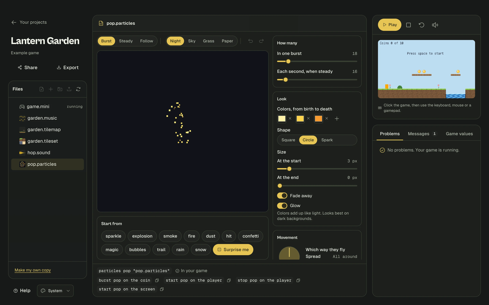

# Particles: sparkles, smoke and explosions

**Particles** are lots of tiny dots that fly out, change color, and fade away. A few lines of them make a game feel alive: a sparkle when you grab a coin, dust when you land, smoke from a chimney.



- [The quickest way](#the-quickest-way)
- [Making your own in Studio](#making-your-own-in-studio)
- [Burst, or keep going](#burst-or-keep-going)
- [All the settings](#all-the-settings)
- [Questions](#questions)

## The quickest way

You don't need any files. Name a ready-made effect, then set it off:

```mini
thing coin
  looks like gold circle 4
  starts at 100, 100

thing player
  looks like orange box 12 by 16
  starts at 90, 100

particles shine like sparkle

when player touches coin
  burst shine on the coin
  remove the coin
```

That's a coin that sparkles when you collect it.

Ready-made effects: `sparkle`, `explosion`, `smoke`, `fire`, `dust`, `hit`, `confetti`, `magic`, `bubbles`, `trail`, `rain`, `snow`.

To change one a little, add lines under it:

```mini
particles boom like explosion
  amount 80
  colors white, red, black
```

## Making your own in Studio

1. Click the **+** button above your files and choose **Particle effect**.
2. Type a name and press Enter.
3. **Click the big picture** to set it off. It also plays by itself.
4. Pick something under **Start from**, or press **Surprise me** until you like it.
5. Move the sliders. The picture changes right away.
6. Click **Add to my game**.

This adds a line that uses your file:

```mini
particles shine "shine.particles"
```

Above the picture, **Burst**, **Steady** and **Follow** change how the preview plays. **Follow** tracks your pointer, so you can see how a trail looks when it moves. The background buttons help you check your colors against the sky or the ground.

## Burst, or keep going

There are two ways to use any effect.

**A burst** is one pop:

```mini
particles shine like sparkle
thing coin
  looks like gold circle 4

thing player
  looks like orange box 12 by 16

when player touches coin
  burst shine on the coin

when space key is pressed
  burst shine at 100, 50
```

**Keeping it going** makes new particles until you stop it. It's good for smoke, fire and trails:

```mini
particles puff like smoke
particles sky like snow
thing chimney
  looks like gray box 20 by 40
  starts at 200, 100
thing player
  looks like orange box 12 by 16

when game starts
  start puff on the chimney
  start sky on the screen

when player touches chimney
  stop puff on the chimney
```

| You can write | What it does |
|---|---|
| `burst shine on the coin` | One pop from the middle of the coin |
| `burst shine at 40, 100` | One pop at a position |
| `start puff on the chimney` | Keeps going, and follows the chimney as it moves |
| `start puff at 40, 100` | Keeps going at a position |
| `start sky on the screen` | Falls from the top of the screen, wherever the camera goes. Made for `rain` and `snow` |
| `stop puff on the chimney` | Stops making new ones. The ones already flying finish on their own |
| `stop puff everywhere` | The same, for every place it was started |

If a thing with an effect on it is removed, its effect stops too.

## All the settings

Write these under a `particles` line, or use the sliders in Studio. Wherever it says `2 to 5`, each particle picks a value between those. You can also give one number.

| Line | What it does | Studio slider |
|---|---|---|
| `amount 30` | How many in one burst | In one burst |
| `rate 20` | How many each second, with `start` | Each second, when steady |
| `life 0.2 to 0.8 seconds` | How long each one lasts | How long each one lasts |
| `speed 20 to 80` | Pixels each second | Speed |
| `direction up` | Which way they fly. Also `down`, `left`, `right`, or degrees: 0 is right, 90 is up | The dial |
| `spread 45` | Degrees of wobble around that direction. 360 goes all around | Spread |
| `gravity 120` | Pulls them down. Negative numbers float up | Gravity |
| `drag 50` | Air slows them. 0 is none, 100 is a lot | Air slows them |
| `size 5 to 0` | Size at the start and at the end, in pixels | Size |
| `colors white, gold, red` | From birth to death, blending between them | Colors |
| `shape circle` | `square`, `circle` or `spark`. A spark is a little streak | Shape |
| `fade` or `no fade` | Turn see-through near the end | Fade away |
| `glow` or `no glow` | Colors add up like light. Looks best on dark backgrounds | Glow |
| `area 40 by 4` | Appear anywhere in a box this big | Start area |

Here's a full campfire:

```mini
particles flames
  rate 45
  life 0.3 to 0.7 seconds
  speed 18 to 48
  direction up
  spread 30
  gravity -40
  size 5 to 1
  colors #fff0a8, orange, firebrick
  shape circle
  glow
  area 8 by 2

when game starts
  start flames at 160, 150
```

## Questions

**Do particles bump into things?**
No. They are only for looks, so you can use thousands without slowing your game or changing how it plays.

**How many can I have?**
Up to 6,000 at once. After that the oldest are reused, so nothing breaks.

**Can rules notice particles?**
No. If you need something that hits things, like a bullet, use a [thing](language.md#things). You can add a `trail` effect to it for looks.

**Can I see how many are flying?**
Yes: the **Game values** tab under your game shows the count.
