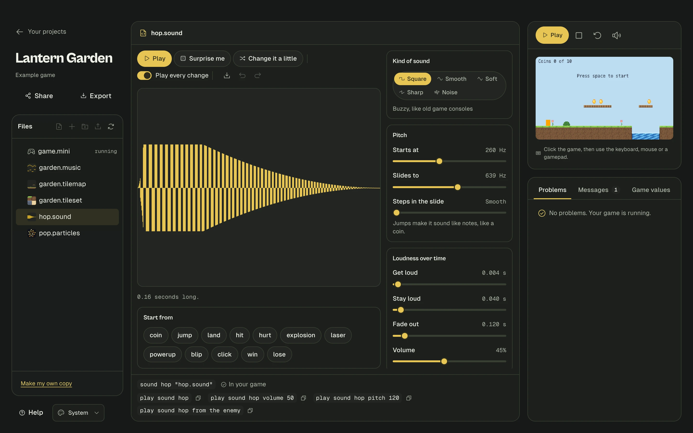
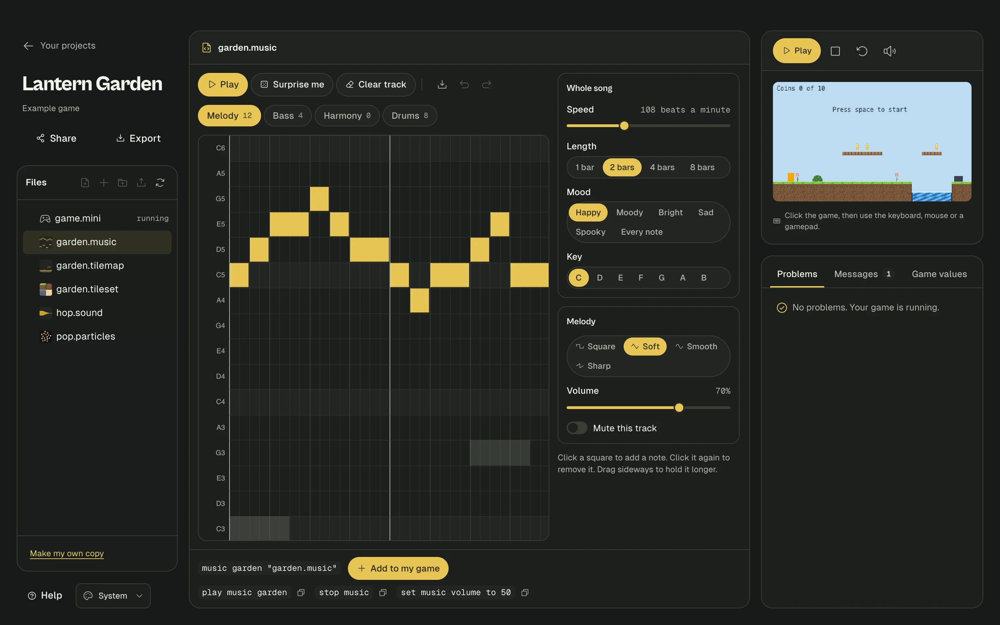

# Sound and music

Add sound effects and looping music to your game. You can use ready-made sounds, shape your own with sliders, write a tune on a grid, or use recordings you already have.



- [The quickest way](#the-quickest-way)
- [Making a sound in Studio](#making-a-sound-in-studio)
- [Making music in Studio](#making-music-in-studio)
- [Using recordings](#using-recordings)
- [Playing sounds in your game](#playing-sounds-in-your-game)
- [All the sound settings](#all-the-sound-settings)
- [Questions](#questions)

## The quickest way

You don't need any files. Name a ready-made sound, then play it:

```mini
thing player
  looks like orange box 12 by 16
  starts at 40, 100
thing coin
  looks like gold circle 4
  starts at 60, 100

sound ding like coin

when player touches coin
  remove the coin
  play sound ding
```

Ready-made sounds: `coin`, `jump`, `land`, `hit`, `hurt`, `explosion`, `laser`, `powerup`, `blip`, `click`, `win`, `lose`.

Try changing one:

```mini
sound low-ding like coin
  pitch 500 to 700
```

## Making a sound in Studio

1. Click the **+** button above your files and choose **Sound**.
2. Type a name and press Enter.
3. Pick something under **Start from**, or press **Surprise me** a few times. **Change it a little** makes small changes to what you have.
4. Move the sliders. Each one plays the sound when you let go. You can turn that off with **Play every change**.
5. Click **Add to my game**.

The picture shows the sound from start to finish. Tall parts are loud. Click it to hear it.

Nothing is recorded, so these files are tiny, and you can come back and change them at any time. The download button saves a real `.wav` recording if you want one elsewhere.

## Making music in Studio



1. Click the **+** button and choose **Music**. It starts with a little tune so you can hear it right away.
2. Press **Play**. It loops, and keeps playing while you change things.
3. **Click a square** to add a note. Click it again to remove it. **Drag sideways** to hold a note longer.

The rows only show notes that fit the **Mood** you chose, so whatever you click sounds right together. There are no wrong notes. Try **Happy** or **Moody**.

| Control | What it does |
|---|---|
| **Melody, Bass, Harmony, Drums** | The tracks, like different instruments playing together. Other tracks show faintly behind the one you're working on |
| **Speed** | Beats a minute |
| **Length** | How long before it loops |
| **Mood** | Which notes the rows offer |
| **Key** | Moves the whole song up or down |
| **Sound** | The kind of sound this track makes |
| **Volume** and **Mute this track** | For each track |
| **Surprise me** | Writes a new tune in this mood. Press it until you hear one you like, then change it |

Click **Add to my game**, then start it in a rule:

```mini
music theme "theme.music"

when game starts
  play music theme
```

## Using recordings

Drag a sound file onto the Files list. `.mp3`, `.wav`, `.ogg` and `.m4a` all work. Click it in Files to listen and see the line to use.

```mini
sound roar "roar.mp3"
music forest "forest.mp3"
  volume 60
```

Recordings make your game bigger, especially when sharing it as a link. Short sounds are fine. For music, a `.music` file is far smaller.

## Playing sounds in your game

| You can write | What it does |
|---|---|
| `play sound ding` | Plays it. Many sounds can play at once |
| `play sound ding volume 50` | Quieter. 100 is normal |
| `play sound ding pitch 150` | Higher. 100 is normal, 50 is lower |
| `play sound boom from the enemy` | Louder when the enemy is close, and it comes from that side of the screen |
| `play music theme` | Loops until it's stopped. Only one tune plays at a time |
| `stop music` | Stops the tune |
| `set sound volume to 50` | All sound effects, from 0 to 100 |
| `set music volume to 50` | The music, from 0 to 100 |

You can mix the options, in any order. The numbers can come from your game too, so a pickup can climb higher with each coin:

```mini
coins starts at 0
sound ding like coin
thing player
  looks like orange box 12 by 16
thing coin
  looks like gold circle 4

when player touches coin
  remove the coin
  add 1 to coins
  play sound ding pitch 100 + coins * 5
```

`restart game` stops the music, so start it again in `when game starts`. A [game state](state-machines.md#states-for-the-whole-game) is the tidy way to have different music for the menu and the game.

## All the sound settings

Write these under a `sound` line, or use the sliders in Studio.

| Line | What it does | Studio slider |
|---|---|---|
| `wave square` | The kind of sound: `square` (buzzy), `sine` (smooth), `triangle` (soft), `saw` (sharp), `noise` (crashes and hits) | Kind of sound |
| `pitch 300 to 900` | Starts at one pitch and slides to another. One number stays still | Starts at, Slides to |
| `steps 3` | Jumps in the slide, so it sounds like notes | Steps in the slide |
| `attack 0.01 seconds` | How long it takes to get loud | Get loud |
| `hold 0.1 seconds` | How long it stays loud | Stay loud |
| `fade 0.3 seconds` | How long it takes to go quiet | Fade out |
| `volume 60` | How loud, from 0 to 100 | Volume |
| `wobble 8 by 30` | Wobbles 8 times a second, by 30% | Wobble speed, Wobble amount |
| `muffle 50` | Like hearing it through a wall | Muffle |
| `crunch 40` | Rough and old-fashioned | Crunch |
| `echo 30` | Repeats | Echo |

```mini
sound zap
  wave saw
  pitch 1400 to 180
  hold 0.02 seconds
  fade 0.14 seconds
  volume 40
```

## Questions

**I can't hear anything.**
Browsers only allow sound after you click or press a key on the page, so nothing plays until then. Music starts as soon as you do. Check the speaker button next to **Restart**, too, and the volume on your computer.

**Sound effects at the very start of my game don't play.**
That's the same rule. Sounds asked for before your first click or key press are skipped. Music waits instead.

**How do people playing my game turn the sound off?**
Exported games show a **Sound on** button in the corner. The M key does the same, unless your game uses M.
