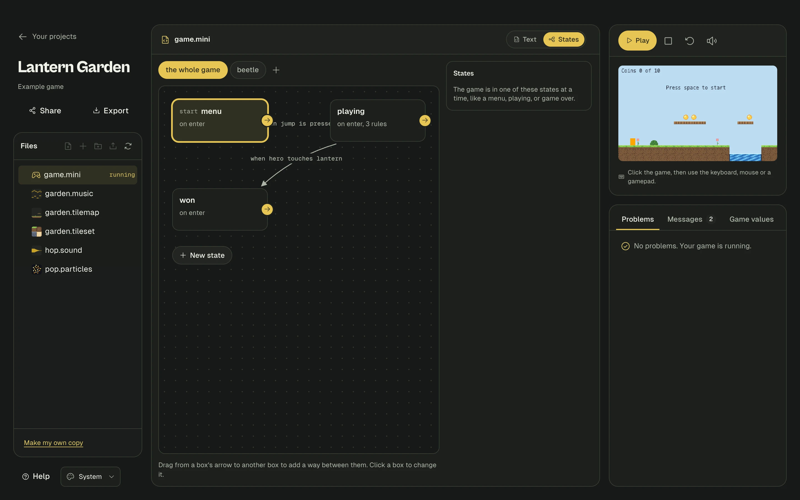

# States: things that act differently at different times

An enemy that walks around, chases you when you get close, and rests when it's tired is doing one thing at a time. Each of those is a **state**. A **state machine** is just a list of states, and what makes it switch from one to another.

Your game can also have states: a menu, then playing, then game over.



You can write states as text or build them as boxes and arrows. They are the same thing, and each one updates the other.

- [Why use states?](#why-use-states)
- [Your first states](#your-first-states)
- [What can go in a state](#what-can-go-in-a-state)
- [Ways to change state](#ways-to-change-state)
- [Every copy has its own state](#every-copy-has-its-own-state)
- [States for the whole game](#states-for-the-whole-game)
- [Using the boxes and arrows](#using-the-boxes-and-arrows)
- [Other rules can use states too](#other-rules-can-use-states-too)
- [Questions](#questions)

## Why use states?

Without states, you keep a number to remember what something is doing, and every rule has to check it:

```mini
guard-mode starts at 0
thing guard
  looks like red box 12 by 16
  starts at 300, 100

when every 2 seconds and guard-mode is 0
  set guard-mode to 1

when guard-mode is 0
  move guard left 1
```

That gets messy quickly, and with more than one guard it doesn't work at all, because a number belongs to the whole game. States keep everything about one mode in one place, and each guard gets its own.

## Your first states

Here's a guard that walks left for 2 seconds, rests for 1 second, and repeats:

```mini
game
  size 320 by 180

thing guard
  looks like red box 12 by 16
  starts at 300, 100

states guard
  state walk
    always
      move guard left 1
    go to rest after 2 seconds

  state rest
    go to walk after 1 second
```

Read it like this: *a guard is either walking or resting. While walking, it moves left. After 2 seconds of walking, it rests. After 1 second of resting, it walks.*

**The first state is where it starts.** That's all you need to know to begin.

## What can go in a state

| Line | What it does |
|---|---|
| `on enter` | The lines under it run once, each time it comes into this state |
| `always` | The lines under it run every moment during this state |
| `on leave` | The lines under it run once, as it goes to another state |
| `when ...` | A normal rule, but it only counts during this state |
| `go to ...` | A way to another state |

All of them are optional, and a state can have as many as it needs:

```mini
thing player
  looks like blue box 12 by 16
  starts at 20, 100
thing guard
  looks like red box 12 by 16
  starts at 300, 100
  animation angry "angry-1.png", "angry-2.png" at 8 fps
sound shout like hurt
hits starts at 0

states guard
  state chase
    on enter
      play sound shout
      play angry on guard
    always
      move guard left 2
    on leave
      stop animation on guard
    when player touches guard
      add 1 to hits
    go to rest after 3 seconds

  state rest
```

Text shown by a state's `on enter` or `always` lines goes away by itself when the state ends, so a "Press space" message leaves with the menu.

Inside a state, the thing's name means *this one*. So `move guard left 2` moves only the guard in that state, not all of them.

## Ways to change state

**After some time:**

```mini
thing guard
  looks like red box 12 by 16
states guard
  state walk
    go to rest after 2 seconds
  state rest
```

**When something is true.** Any [condition](language.md#conditions-checking-if-something-is-true) works, and it's checked every moment:

```mini
thing guard
  looks like red box 12 by 16
thing player
  looks like blue box 12 by 16
states guard
  state walk
    go to chase when player x is above guard x
  state chase
```

**When something happens.** Any [`when` trigger](language.md#everything-a-rule-can-wait-for) works, like a key or a touch:

```mini
thing guard
  looks like red box 12 by 16
thing player
  looks like blue box 12 by 16
states guard
  state walk
    go to stunned when player touches guard
    go to stunned when space key is pressed
  state stunned
```

**From any rule, anywhere in your game:**

```mini
thing guard
  looks like red box 12 by 16
states guard
  state walk
  state stunned

when z key is pressed
  set guard state to stunned
```

If several `go to` lines could happen at once, the first one wins.

## Every copy has its own state

Add as many guards as you like. One can be chasing while another rests:

```mini
thing guard
  looks like red box 12 by 16
  starts at 100, 100
  starts at 200, 100
  starts at 300, 100

states guard
  state walk
    always
      move guard left 1
    go to rest after 1 second
  state rest
    go to walk after 1 second
```

New ones made with `make a guard at 40, 100` start in the first state, on their own timer.

## States for the whole game

Use `states game` for one state that the whole game is in. It's the neat way to do a title screen and game over:

```mini
game
  size 320 by 180

music theme "theme.music"
sound fail like lose

thing player
  looks like orange box 12 by 16
  starts at 40, 100
thing lava
  looks like red box 320 by 20
  starts at 0, 160

states game
  state menu
    on enter
      show text "Press space to play" at 90, 60
    go to playing when space key is pressed

  state playing
    on enter
      play music theme
    when right key is held
      move player right 2
    when left key is held
      move player left 2
    go to over when player touches lava

  state over
    on enter
      stop music
      play sound fail
      show text "Game over" at 130, 60
    when r key is pressed
      restart game
```

Movement rules live inside `playing`, so nothing moves during the menu. No extra checks are needed.

## Using the boxes and arrows

Open your game file and press **States** at the top, next to **Text**.

| To do this | Do this |
|---|---|
| **Start** | Click **Give player states**, or **Give the whole game states** |
| **Add a state** | Click **New state** |
| **Connect two states** | Drag from the round arrow on one box onto another box. Studio asks what should make it switch, and offers time, a key, a touch, or something being true |
| **Move a box** | Drag it |
| **Change what it does** | Click the box. Type actions under **When it starts**, **All the time** and **When it stops**, one per line |
| **Change or remove a way out** | Click the box, and look under **Ways out** |
| **Choose the first state** | Click the box, then **Start here instead** |
| **Rename** | Click the box and change its name. It's updated everywhere it's used |

**While your game runs, the box each thing is in lights up**, with a number showing how many are in it. It's a great way to see why something isn't doing what you expect.

Everything you do here writes ordinary lines in your game file. Press **Text** to see them. If you type a mistake in a box, the **Problems** tab under the game tells you, the same as usual.

## Other rules can use states too

| You can write | What it means |
|---|---|
| `when guard is in chase` | A condition. Once, the moment it becomes true |
| `when player touches guard and guard is in rest` | Add it to any rule. Here, the rule only counts for a resting guard |
| `game is in playing` | The same, for the game |
| `set guard state to chase` | Change state from any rule |
| `set game state to over` | The same, for the game |
| `when guard enters chase` | Runs when any guard comes into that state. `the guard` means that one |
| `when guard leaves chase` | Runs when any guard goes out of that state |
| `when game enters over` | The same, for the game |
| `guard state time` | How many seconds it has been in this state, as a number |
| `game state time` | The same, for the game |

```mini
thing guard
  looks like red box 12 by 16
  starts at 100, 100
states guard
  state walk
    go to rest when guard state time is above 2
  state rest
    go to walk after 1 second

when guard enters rest
  show text "Phew" at 4, 4
```

## Questions

**Can one thing have two state machines?**
No. Each thing has one `states` block, and the game has one.

**What about the states when the game restarts?**
`restart game` puts everything back, so every copy and the game go back to their first state.

**Do I still need normal rules?**
Yes, and they keep working as usual. They run first in each moment, then each state's `always` lines and `go to` checks. Use normal rules for things that are always true, and states for things that depend on what a thing is doing.

**Where can I see what state something is in?**
Besides the boxes and arrows, the **Game values** tab under your game has a **States** section.
