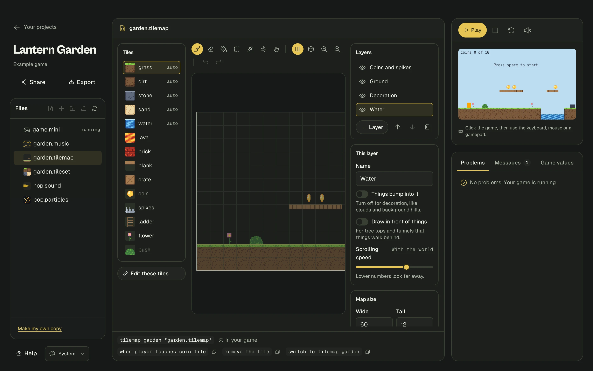
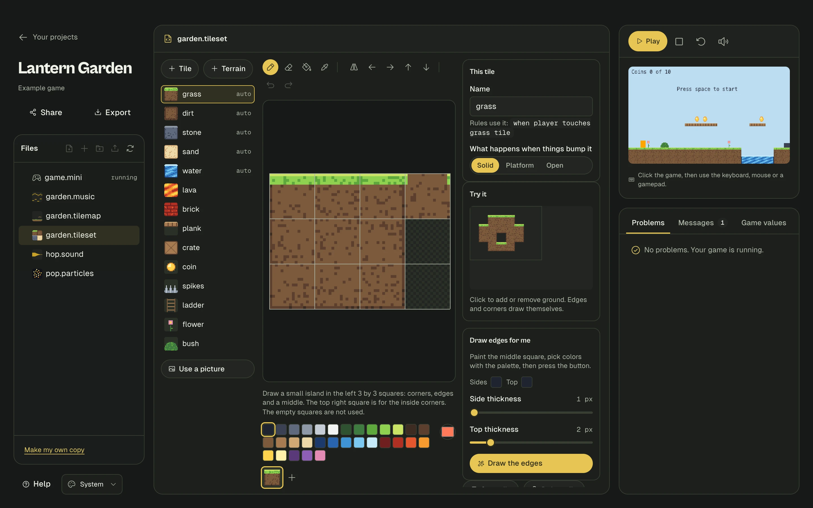

# Tile maps: paint your levels

A **tile map** is a level made of small square pictures, called **tiles**, laid out on a grid, like a floor made of bathroom tiles. Instead of placing every wall by hand, you pick a tile and paint with it.



- [Your first tile map in one minute](#your-first-tile-map-in-one-minute)
- [Painting](#painting)
- [Autotile: ground that draws its own edges](#autotile-ground-that-draws-its-own-edges)
- [Layers](#layers)
- [Placing things on the map](#placing-things-on-the-map)
- [Making your own tiles](#making-your-own-tiles)
- [Using tiles in your rules](#using-tiles-in-your-rules)
- [More than one level](#more-than-one-level)
- [Questions](#questions)

## Your first tile map in one minute

1. In Studio, click the **+** button above your files and choose **Tile map**.
2. Type a name, like `cave`, and press Enter. Studio also makes a tile set for you, full of ready-made tiles.
3. Click **Add to my game** at the bottom. This puts one line in your game:

   ```mini
   tilemap cave "cave.tilemap"
   ```

4. Your game restarts with the ground from your map. Paint something and watch it appear in the game on the right.

For your player to stand on the ground, it needs `solid` and `falls`, and your game needs some `gravity`:

```mini
game
  size 320 by 180
  pixel art
  gravity 0.4

tilemap cave "cave.tilemap"

thing player
  looks like orange box 12 by 16
  starts at 40, 20
  solid
  falls
  camera follows
```

That's all. There are no walls to place and no `starts at` lines for the ground. The camera also stays inside the map by itself.

## Painting

Pick a tile on the left, then click or drag on the map. On a phone or tablet, use your finger.

| Tool | Key | What it does |
|---|---|---|
| **Paint** | B | Draw with the tile you picked |
| **Erase** | E | Take tiles away. The right mouse button also erases, in any tool |
| **Fill** | G | Fill a whole area, like a paint bucket |
| **Rectangle** | R | Drag to paint a box |
| **Pick** | I | Click a tile on the map to paint with that one |
| **Things** | T | Place things from your game. See [below](#placing-things-on-the-map) |
| **Move around** | hold Space | Drag to move your view. The mouse wheel and the middle button work too |

Other handy things:

- **Zoom** with the magnifying glass buttons, or Ctrl and the mouse wheel.
- **Undo** with Ctrl+Z (Cmd+Z on a Mac).
- **The cube button** shows what is solid. Red squares stop things. Blue strips are platforms.
- **Under the map**, a line tells you the position of the tile you are pointing at, like `x 64, y 48`. Those are the numbers to use in your rules.
- **Map size** is on the right.

Your work saves by itself, and the game restarts with your changes a moment after you stop painting.

## Autotile: ground that draws its own edges

Some tiles have the word **auto** next to them. These are **terrain** tiles. Just paint a blob anywhere, and the tile works out its own grassy top, its sides and even its inside corners, by looking at the tiles around it.



So you never have to choose between "top left corner of grass" and "right edge of grass". You paint with **grass**. When you erase a tile, the ones around it fix themselves.

This also works while the game is running. If a rule removes a piece of grass, the edges around the hole redraw.

### Making your own terrain

Open your tile set, and click **+ Terrain**. You get a picture 4 squares wide and 3 tall:

- **The left 3 by 3 squares** are a tiny island: four corners, four edges and a middle.
- **The top right square** is for inside corners, the bits you see where a hole cuts into the ground.
- **The other two squares** are not used.

You don't have to draw all of that:

1. Paint just the **middle square**, the one in the center of the island.
2. Under **Draw edges for me**, click **Sides** and **Top** to use the color you have picked, and set how thick they are.
3. Click **Draw the edges**.

Then try it in the **Try it** box by clicking to add and remove ground. Touch up any piece by hand if you like.

## Layers

Layers are like sheets of clear plastic stacked on top of each other. Each one holds its own tiles. Most levels use a few:

| Layer | Example | Things bump into it | In front of things |
|---|---|---|---|
| Far hills | Slow scrolling background | Off | Off |
| Decoration | Flowers, bushes | Off | Off |
| Ground | The floor and walls | **On** | Off |
| Tree tops | Leaves you walk behind | Off | **On** |

Click a layer to paint on it. Other layers turn see-through, so yours stands out.

| Setting | What it does |
|---|---|
| **Eye button** | Show or hide the layer |
| **Things bump into it** | When off, even solid tiles on this layer don't stop anything |
| **Draw in front of things** | Draw over your player instead of behind them |
| **Scrolling speed** | Lower looks further away. At 50% the layer moves half as fast as the world. At 0 it stays still |

## Placing things on the map

Press **T** (or the running person button), then pick a thing from the list on the left, and click the map. This is much quicker than writing `starts at` lines. Click it again to remove it.

The list comes from the `thing` blocks in your game. The placed things are real things, and rules work on them as usual:

```mini
thing beetle
  looks like black box 14 by 9
  solid
  falls

when player touches beetle
  restart game
```

Don't give a thing `starts at` lines if you place it on the map, or you will get both.

## Making your own tiles

Click **Edit these tiles** in a tile map, or open any `.tileset` file. Pick a tile on the left, then paint its pixels in the middle.


| Tool | What it does |
|---|---|
| **Pencil** | Paint one pixel. Drag for more. The right mouse button picks up a color |
| **Eraser** | Make pixels see-through |
| **Fill** | Fill an area |
| **Color picker** | Click a pixel to use its color |
| **Mirror** | Paint both sides at once, great for symmetrical things |
| **Arrows** | Slide the picture, wrapping around. Use them to check that a tile repeats without a visible seam |

The **+** swatch next to the colors adds your own color.

Every tile has settings on the right:

| Setting | What it means |
|---|---|
| **Name** | What your rules call it. Letters, numbers and dashes |
| **Solid** | Solid things can't pass through it |
| **Platform** | Stand on it, and jump up through it from below |
| **Open** | Things pass through it. You can still notice them touching it with a rule |

### Animated tiles

Under the colors is a row of **frames**. Click **+** to add a frame, which starts as a copy of the current one, then change it a little. Add a few and the tile plays them in a loop, like the water and coins in the starter tiles. Set how fast with **Animation speed**. The stack button shows the previous frame faintly, to help you line things up.

### Using a picture you already have

Click **Use a picture** and choose a PNG. It is cut into squares the size of your tiles. Empty squares and repeated squares are skipped, and each new tile starts as solid.

## Using tiles in your rules

Tiles have names, so rules can notice them. Here's a coin you painted on the map:

```mini
when player touches coin tile
  remove the tile
  add 1 to score
```

**The tile** means the one that was touched, just like **the coin** means the coin that was touched.

| You can write | What it means |
|---|---|
| `when player touches lava tile` | While they overlap. Edges count, like with things |
| `when player touches any tile` | Any tile at all |
| `remove the tile` | Take away the tile that was touched |
| `set the tile to grass` | Change it to another tile |
| `set tile at 32, 48 to grass` | Change the tile at a position in the world |
| `remove tile at 32, 48` | Take away the tile at a position |
| `player is on grass tile` | A condition: standing on it |
| `player is touching lava tile` | A condition: overlapping it. Also `player is touching any tile` |
| `tile at 32, 48 is lava` | A condition: what is at that spot |
| `tile x` and `tile y` | Where the touched tile is, in a rule about touching a tile |

A breakable block that bursts when you hit it from below looks like this:

```mini
particles bits like dust

when player touches brick tile and player vy is below 0
  burst bits at tile x + 8, tile y + 8
  remove the tile
```

## More than one level

Add a tile map for each level. Add `hidden` under the ones that shouldn't show at the start:

```mini
tilemap level-1 "level-1.tilemap"

tilemap level-2 "level-2.tilemap"
  hidden

when player touches door
  switch to tilemap level-2
  set player x to 20
  set player y to 100
```

`switch to tilemap` shows only that map, removes the things the old map placed, and brings in the things the new map places. `show tilemap` and `hide tilemap` turn one on or off without changing anything else, which is handy for a secret passage.

A tile map can start somewhere other than the top-left corner:

```mini
tilemap bonus "bonus.tilemap"
  at 640, 0
```

## Questions

**How is this different from a `map` block?**
A [`map`](language.md#maps-build-levels-from-letters) is written with letters in your game file, and each letter makes a real thing. It's good for a few dozen things that move or get collected. A tile map is painted, draws with real tile art, and handles huge levels easily, because tiles aren't things. Use both together if you like.

**My player falls through the ground.**
Check three things: the player has `solid` in its block, the tile says **Solid** in the tile set, and the layer has **Things bump into it** on.

**The camera won't leave the map.**
That's on purpose. To change it, use your own [`camera stays inside`](language.md#game-settings) line in the `game` block.

**It says it can't find my file.**
If you rename a tile map or tile set file, update the name in your game file too. Files are looked for next to your game, then in an `assets` folder.
